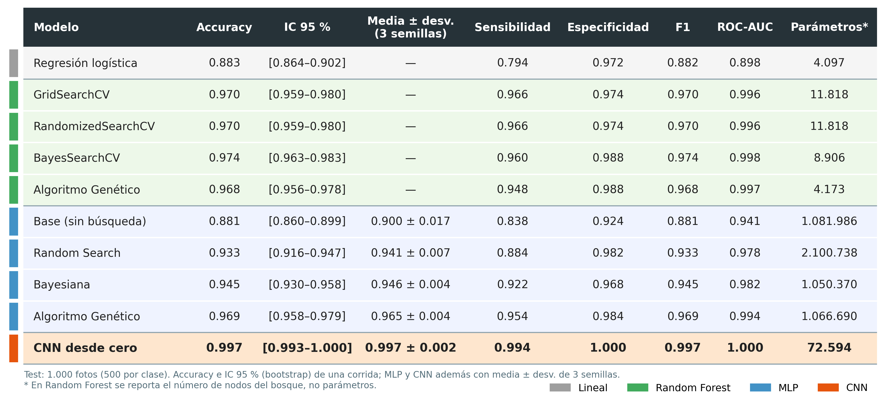
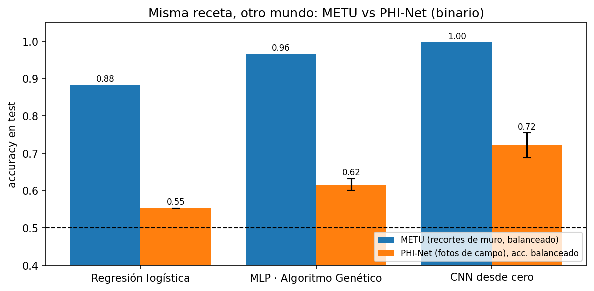

# Crack Detection with Optimized Models

Concrete crack detection (crack / no crack) comparing 10 models whose hyperparameters were tuned with **grid search, random search, Bayesian optimization and a genetic algorithm under the same evaluation budget**, then stress-tested on real field photos.

Team project · *Optimization & AI*, Universidad Nacional de Colombia (Medellín), 2026-2. The goal it points to: automated structural inspection from field photos.

## Results (test set, 1,000 balanced images, 64×64 grayscale)

| Model | Test accuracy | 95% CI | F1 macro | ROC AUC | Params |
|---|---|---|---|---|---|
| Logistic regression | 0.883 | 0.864–0.902 | 0.882 | 0.898 | 4K |
| Random Forest · Bayesian search | 0.974 | 0.963–0.983 | 0.974 | 0.998 | — |
| MLP · base | 0.881 | 0.860–0.899 | 0.881 | 0.941 | 1.08M |
| MLP · genetic algorithm | 0.969 | 0.958–0.979 | 0.969 | 0.994 | 1.07M |
| **CNN from scratch** | **0.997** | **0.993–1.000** | **0.997** | **1.000** | **72K** |

- **Search methods, same budget (15 evaluations):** the genetic algorithm found the best MLP (mean val. accuracy 0.924 vs 0.905 Bayesian and 0.895 random) and lifted it from 0.881 to 0.969 on test.
- **Robustness:** MLP and CNN results averaged over 3 seeds (CNN 0.997 ± 0.002).
- **Optimizer × learning rate sweeps**, convergence speed, regularization ablation (L2, dropout, BatchNorm) and learning curves are in `results/`.
- **Lab-to-field gap:** on real field photos (PHI-Net Task 8, collapsed to binary) the CNN drops to **0.72 balanced accuracy** (MLP 0.62, logistic 0.55). Clean lab images are not enough for deployment; this is the next problem to solve.

## Data
- **METU Concrete Crack Images** (Özgenel, 2019), public on Mendeley Data (`5y9wdsg2zt`). Sample: 2,000 train / 500 validation / 1,000 test, balanced.
- **PHI-Net Task 8** (PEER, UC Berkeley) for the field test.

The notebook downloads both automatically; datasets are not stored in this repo.

## Run
Open `crack_detection_optimized_models.ipynb` in Google Colab (GPU recommended) and run all cells. Stack: Python, NumPy, pandas, OpenCV, scikit-learn, scikit-optimize, Keras / Keras Tuner, PyGAD, PyTorch, Matplotlib. Notebook comments are in Spanish.

## Files
- `crack_detection_optimized_models.ipynb` — full pipeline, executed.
- `results/RESUMEN_METRICAS.md` — all metrics tables (Spanish).
- `results/*.csv` — raw metrics, confusion matrices, sweeps.
- `results/figures/` — plots.
